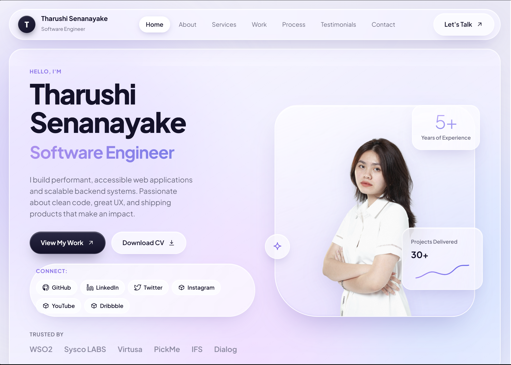

<p align="center">
  
</p>

# 🚀 Developer Portfolio Template

A high-performance, glassmorphic developer portfolio template built with **Next.js 14**, **TypeScript**, and **CSS Grid**. Crafted with Apple-inspired frosted glass materials, fluid micro-interactions, responsive typography, and a single-file configuration architecture.

Fork it, personalize one config file, drop your images, and deploy to Vercel or any static host in under 5 minutes.
<p align="center">
  <strong><a href="https://glassy-folio.vercel.app/" target="_blank">🌐 View Live Demo</a></strong>
</p>

[](https://nextjs.org/)
[](https://www.typescriptlang.org/)
[](LICENSE)
[](https://github.com/sewmina-as)

---

## ✨ Highlights & Features

- **⚡ One-File Configuration (`lib/config.ts`)**: Personalize profile details, hero copy, social links, project showcases, services, skills, testimonials, and SEO tags from a single typed file.
- **💎 Apple Frosted Glass Aesthetic**: Dual specular rim-lights, optical depth, ambient lilac/indigo refraction, and smooth hover elevation.
- **🖼️ Built-in Project Showcases**: macOS-styled glass browser windows displaying real project screenshots (`project1.jpg`, `project2.jpg`, `project3.jpg`).
- **🌐 Creative Social Media Docks**: Floating frosted-glass icon dock in the Hero section, quick-access glass buttons in the Footer, and interactive cards in the Contact area.
- **📱 100% Fully Responsive**: Pixel-perfect layout adaptation across mobile (320px+), tablet, laptop, and ultrawide monitors.
- **♿ Accessibility & Performance First**: Semantic HTML5, ARIA compliance, full keyboard navigation, and automatic `prefers-reduced-motion` support.
- **🔍 Comprehensive SEO & Social Cards**: Built-in OpenGraph, Twitter cards, meta robots, and local tab favicon (`icon.svg`).
- **🚀 Zero Heavy UI Frameworks**: No Tailwind or Bootstrap bloat — ultra-fast handcrafted CSS running on standard Next.js primitives.

---

## 📁 Project Structure

```
├── app/
│   ├── globals.css          # Apple glass design system & responsive styling
│   ├── layout.tsx           # SEO metadata, preconnect headers & font setup
│   ├── page.tsx             # Main landing page with all modular sections
│   └── icon.svg             # Local tab favicon (Next.js App Router native)
├── components/
│   ├── ContactForm.tsx      # Contact form with validation & loading state
│   ├── Icon.tsx             # Self-contained local inline SVG icons (zero internet dependencies)
│   ├── Navbar.tsx           # Floating glass pill navbar with scroll tracking
│   ├── Portrait.tsx         # Profile photo loader with automatic initials fallback
│   └── Reveal.tsx           # Scroll-triggered viewport animation wrapper
├── lib/
│   ├── config.ts            # ⭐ YOUR CONFIG — edit this single file to customize everything
│   └── data.ts              # Type-safe re-export layer for React components
├── public/
│   ├── dp.png               # Profile portrait image
│   ├── icon.svg             # Local SVG browser tab logo
│   ├── project1.jpg         # Featured project 1 preview screenshot
│   ├── project2.jpg         # Featured project 2 preview screenshot
│   └── project3.jpg         # Featured project 3 preview screenshot
├── .env.example             # Optional environment variable template
├── LICENSE                  # MIT License (Copyright Achintha Sewmina)
├── CONTRIBUTING.md          # Open-source contribution guidelines
└── README.md                # Documentation & setup guide
```

---

## 🚀 Quick Start

### 1. Clone & Install

```bash
git clone https://github.com/Sewmina-as/GlassyFolio.git
cd GlassyFolio
npm install
```

### 2. Personalize in `lib/config.ts`

Open [`lib/config.ts`](lib/config.ts) and customize your data:

```typescript
export const siteConfig: SiteConfig = {
  siteTitle: "Your Name — Software Engineer",
  siteDescription: "Your personal portfolio description for SEO...",
  
  profile: {
    name: "Your Name",
    role: "Full-Stack Engineer",
    initials: "YN",
    email: "your.email@example.com",
    phone: "+94 7X XXX XXXX",
    location: "Colombo, Sri Lanka",
    portraitPath: "/dp.png",
    faviconPath: "/icon.svg",
  },
  
  // Add your social links (with local SVG icon names)
  socials: [
    { platform: "GitHub", url: "https://github.com/yourhandle", label: "GitHub Profile", icon: "github" },
    { platform: "LinkedIn", url: "https://linkedin.com/in/yourhandle", label: "LinkedIn Profile", icon: "linkedin" },
    { platform: "Twitter", url: "https://twitter.com/yourhandle", label: "Twitter Profile", icon: "twitter" },
    { platform: "Instagram", url: "https://instagram.com/yourhandle", label: "Instagram", icon: "instagram" },
  ],
  
  // Featured project screenshots
  projects: [
    {
      title: "My SaaS Platform",
      kind: "Full-Stack Web App",
      hue: "violet",
      image: "/project1.jpg",
      url: "https://github.com/yourhandle/project-1",
    },
    // ...
  ],
  
  footer: {
    ownerName: "Your Name",
    text: "All rights reserved.",
    showBackToTop: true,
  },
};
```

### 3. Replace Static Images in `/public`

- **Portrait**: Place your photo at `public/dp.png`
- **Tab Icon**: Replace `public/icon.svg` (and `app/icon.svg`) with your SVG logo
- **Project Previews**: Add your screenshots to `public/project1.jpg`, `public/project2.jpg`, and `public/project3.jpg`

### 4. Run Locally

```bash
npm run dev        # Development server → http://localhost:3000
npm run type-check # Run TypeScript validation
npm run build      # Compile production build
npm start          # Run compiled production server
```

---

## 🎨 Customization Guide

### Colors & Theming

All theme variables live in [`app/globals.css`](app/globals.css) under `:root`:

```css
:root {
  --ink: #14122b;       /* Dark text color */
  --muted: #6b6a80;     /* Muted subtitle gray */
  --violet: #8b6cf0;    /* Primary brand accent */
  --indigo: #6366f1;    /* Secondary brand accent */
}
```

### Adding New Social Icons

All icons are locally rendered SVG paths in [`components/Icon.tsx`](components/Icon.tsx). To add a new platform:
1. Add an SVG path to `paths` inside `components/Icon.tsx`:
   ```typescript
   myplatform: "M12 2C6.48 2 ...",
   ```
2. Reference the icon in `lib/config.ts`:
   ```typescript
   { platform: "MyPlatform", url: "https://...", label: "Profile", icon: "myplatform" }
   ```

### Connecting the Contact Form

The contact form in [`components/ContactForm.tsx`](components/ContactForm.tsx) includes client-side validation and simulated network latency. To connect an email backend:
1. Set up an API route at `app/api/contact/route.ts` with your email service (e.g. Resend, SendGrid, or Nodemailer).
2. Add your API credentials to `.env.local` (see [`.env.example`](.env.example)).
3. Uncomment the `fetch("/api/contact", ...)` call in `ContactForm.tsx`.

---

## 🚢 Deployment

### Deploy with Vercel (Recommended)

[](https://vercel.com/new/clone?repository-url=https://github.com/sewmina-as/portfolio-template)

1. Push your repository to GitHub.
2. Import the project into [Vercel](https://vercel.com).
3. Vercel automatically detects Next.js and builds the site.

### Deploy to Other Platforms

- **Netlify**: Run `npm run build` with the `@netlify/plugin-nextjs`.
- **Docker**: Build using Next.js standalone output.
- **Static HTML Export**: Add `output: 'export'` to `next.config.mjs` to generate a pure static `out/` folder for GitHub Pages or AWS S3.

---

## 📄 License & Ownership

Created and maintained as a Free and Open-Source Software (FOSS) project by **[Achintha Sewmina](https://github.com/sewmina-as)**.

Released under the **[MIT License](LICENSE)**. You are free to fork, customize, and use this template for personal or commercial portfolios. Attribution is appreciated!
